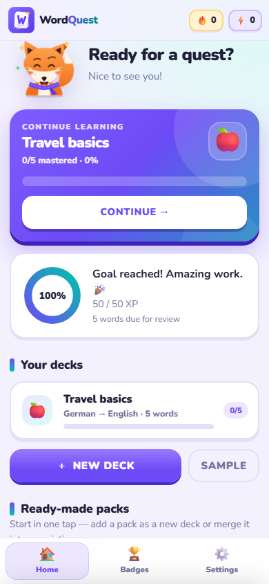
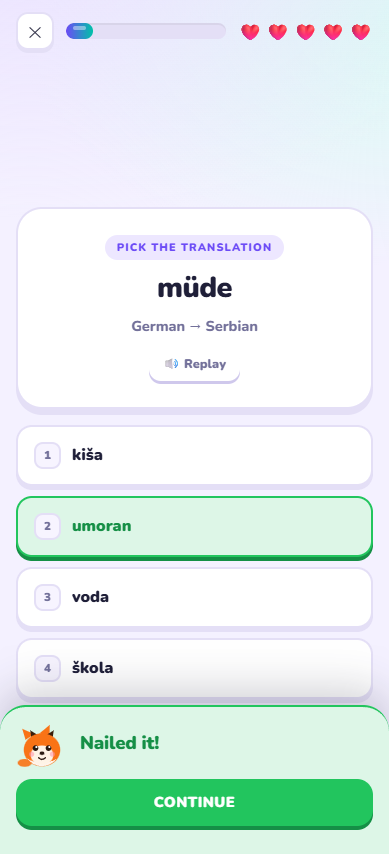

# WordQuest 🦊

Turn any word list into an adaptive language-learning game. Import your own pairs, let WordQuest
work out the languages, and practise with spaced repetition, nine exercise types and a friendly fox
called Pip.

No backend, no accounts, no tracking — your decks and progress stay in this browser.

<p align="center">
  
  
</p>

## Why

Most vocabulary apps make you pick a course from their catalogue. WordQuest starts from *your* list:
a text file, a pasted column from a spreadsheet, or one of the built-in packs. Everything else —
language detection, exercise choice, difficulty — adapts to that list.

## Features

### Ready-made packs
- **31 curated packs** across German, English, Italian, Spanish and French, lazy-loaded so they cost
  nothing until you browse them. Every language has food, travel, home and verb packs; German adds
  health, nature, work, city and feelings themes, and English/Italian/Spanish/French include
  everyday phrases. German and English each keep a 300-word starter list.
- Filter by **language and category**, or search by title, description, language or level; preview
  the first ten pairs before committing.
- Add a pack as a **new deck**, or **merge** it into a deck with the same language pair. Duplicates
  are skipped by normalised foreign word, and the deck records which pack it came from.
- Adding a pack skips the language-confirmation step; the pack already knows its pair.
- The Add words screen shows a five-card teaser (one pack per language) below the paste box, so
  importing is not the only way to get started.

### Import and decks
- **Three ways in:** drag & drop, file picker, or paste text.
- **Flexible format:** `-` `–` `—` `=` `:` `;` tab and comma all separate the two sides.
- Skips blank lines and `#` comments, strips a UTF-8 BOM, merges duplicate words, and keeps several
  translations per word.
- **Editable preview** before saving — fix a line or delete a row; unparseable lines are reported
  with their line numbers instead of failing silently.
- Unlimited decks. Rename, delete, or switch between them at any time.

### Language detection
- Works offline: script ranges, stopword lists, diacritics and character n-grams.
- Nothing is applied silently: before the word list appears, WordQuest shows the pair it detected
  (with a few sample words from each column) and waits for you to confirm. Picking a different
  language — or swapping the two columns for lists written translation-first — is one tap away.
- Serbian is supported in both scripts (Latin and Cyrillic), including transliteration between them.
- Optional accent-insensitive matching (`cafe` = `café`) for typing exercises.

### Nine ways to practise
| Mode | What it trains |
| --- | --- |
| Flashcards | Self-graded recall, both directions |
| Multiple choice | Recognition, foreign → native and native → foreign |
| Type it | Production, with a progressive hint and typo tolerance (Levenshtein) |
| Memory match | Pair foreign words with translations |
| Emoji link | Pick the word from a picture |
| Listen & pick | Ear training with text-to-speech |
| Letter scramble | Spelling and word shape |
| Speed round | 60 seconds, combo multiplier, one point per correct answer |
| Boss round | Mixed-mode test unlocked by trouble words |

A lesson is 10–15 exercises, so it fits in a coffee break.

### Adaptive repetition
- Every word carries a mastery level from 0 to 5 (Leitner-style).
- Wrong answers are requeued in the same session and weighted heavier next time.
- Mastery 5 requires success in at least two different exercise types.
- Words you keep missing are collected in **trouble words**, which unlock a **boss round**.

### Pronunciation that actually sounds right
Three selectable engines:
- **Auto** — prefers a natural installed system voice, otherwise uses the online voice. If the
  network is unavailable it falls back to an installed voice in the right language. This is the
  default, and it fixes languages your OS has no voice for (for example Hungarian on a PC that only
  ships English voices).
- **Browser** — offline Web Speech only. If the language has no installed voice, playback is skipped
  instead of reading the word with an unrelated English voice.
- **Online** — Google Cloud Text-to-Speech with your own API key, with a keyless Google Translate
  fallback when no key is set.

The API key is stored only in your browser's `localStorage`; it is never sent anywhere except to
Google. Synthesised audio is cached in memory so repeated words do not hit the network twice.

### Progress and profiles
- XP, levels, daily goal, streak, hearts, combos, badges and confetti.
- **Local profiles**: several people can share one device, each with their own decks, XP and
  settings. Profiles can be protected with a PIN (salted SHA-256 — a lock, not encryption).
- Export and import all progress as JSON, or reset it, per profile.

### Small things that matter
- Light and dark themes.
- Keyboard: `Enter` to continue, `1`–`4` to answer, `Space` to flip a card, `Esc` to leave.
- Respects `prefers-reduced-motion`, visible focus rings, ARIA labels, and a skip link.
- UI available in English and Serbian (Latin); it can default to the language you are learning from.
- Works on a phone — the layout is mobile-first, not a shrunken desktop page.
- App icons use the purple-and-white **W** card mark, with a web app manifest for
  favicons, home-screen shortcuts and installable windows.

## Run it

Requires Node 20.19+ (developed with Node 22).

```bash
git clone https://github.com/djurkeceo/wordquest.git
cd wordquest
npm ci
npm run dev
```

Vite prints a local URL (usually `http://localhost:5173`). Click **Sample** for a 40-word German →
Serbian deck, or open **Ready-made packs** and add one.

### Build and test

```bash
npm run typecheck   # strict TypeScript, no emit
npm test            # Vitest characterisation + preset tests
npm run build       # typecheck + production build into dist/
npm run preview     # serve dist/ on a local port
```

Deploy `dist/` to any static host. On Vercel: framework preset **Vite**, build command
`npm run build`, output directory `dist`. No environment variables and no server code are needed.

## Project structure

```
src/
  main.ts          boot order, bindings, session host
  types.ts         strict domain contract
  storage/         profiles, state, migration, PIN hashing
  parser/          word-list parser and separators
  language/        detection, names, normalisation
  emoji/           lazy lexicon + word-to-emoji inference
  engine/          SRS, XP, answer checking, session builder
  modes/           the nine exercise renderers
  audio/           sound effects and text-to-speech
  gamification/    achievements and level maths
  ui/              router, screens, shared components
  i18n/            English and Serbian catalogues
  presets/         registry, merge logic, UI, data/*.txt
  styles/          CSS split by concern, imported by main.ts
public/            icons and site.webmanifest
```

### Adding a ready-made pack

1. Drop a plain text file into `src/presets/data/` — one pair per line, e.g. `der Hund - pas`.
2. Add one entry to `PRESETS` in `src/presets/index.ts` with both titles/descriptions, the language
   pair, category, level and `load: () => import('./data/your-pack.txt?raw')`.

The card's word count is parsed from the file, so there is no count to keep in sync. Pack text is a
separate lazy chunk in the production build.

## State and privacy

- Profiles: `wordquest.profiles.v1` (`{ activeId, list }`).
- Each profile: `wordquest.state.v1::<profileId>`.
- Settings, decks, progress and the optional TTS key live inside that profile state.
- A legacy `wordquest.state.v1` save is adopted by the first profile.
- Nothing is uploaded. Export JSON from Settings for a backup, or import it on another device.

## Browser support

Current Chrome, Edge, Firefox and Safari. Speech quality depends on the voices installed on your
system; the online engine covers the gaps.

## License

MIT — see [LICENSE](LICENSE). Use it, change it, ship it.
